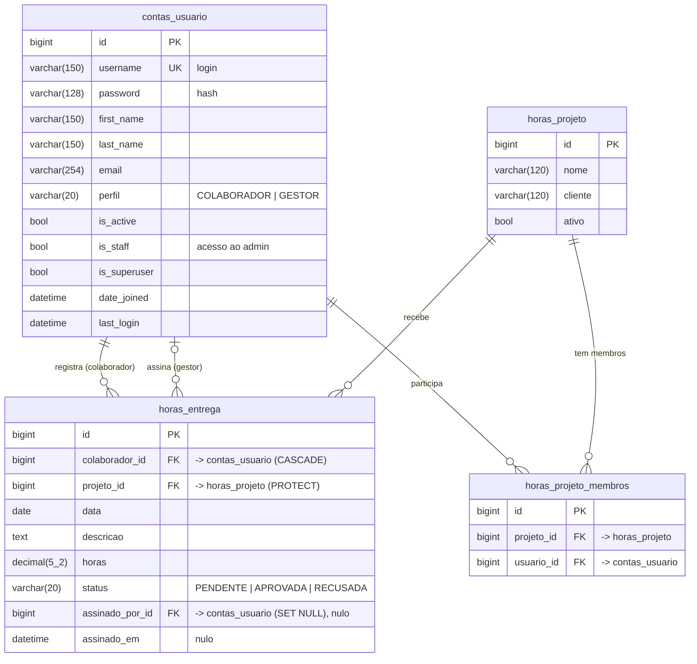

# PontoCerto

Sistema para entrega, assinatura e contabilização de horas trabalhadas pelos colaboradores de uma empresa.

## Integrantes
- Igor Garcia Rezende
- Mateus Milani

## Descrição
O colaborador registra suas entregas (projeto, data, descrição e horas trabalhadas).
O gestor assina (aprova) ou recusa cada entrega. O total de horas de cada colaborador considera apenas as entregas assinadas.

## Tecnologias
- Python 3 / Django 6
- SQLite (banco relacional)
- [Unfold](https://unfoldadmin.com) (construído sobre o framework CSS **Tailwind CSS**) — tema do Django Admin
  **e** das telas da área do usuário: todas as telas seguem o mesmo visual, responsivo, com tema claro/escuro
- [HTMX](https://htmx.org) 2 (já incluso no Unfold) — telas atualizam só o trecho que mudou, sem recarregar a página

### Por que não Edge Rendering
Edge Rendering é gerar o HTML em servidores de borda de uma CDN (Cloudflare Workers, Vercel Edge).
Esses ambientes só executam JavaScript/WebAssembly e não têm acesso a um banco relacional local;
o Django precisa de um processo Python e do SQLite/servidor de banco. Usar Edge Rendering exigiria
reescrever o back-end em outra linguagem e abandonar o Django, que é requisito do trabalho.
No lugar, a renderização fica no servidor Django e o **HTMX** troca só o fragmento de HTML alterado
(mesmo ganho de "página que não recarrega inteira"), e a interface usa o **Unfold/Tailwind CSS** em todas
as telas, que já traz responsividade e tema claro/escuro. CSS e JS são servidos pelo próprio Django (sem CDN).

## Instalação
```bash
python -m venv .venv
.venv\Scripts\activate        # Linux/Mac: source .venv/bin/activate
pip install -r requirements.txt
python manage.py migrate
python manage.py popular       # dados de demonstração
```

## Execução
```bash
python manage.py runserver
```
- Área do usuário: http://127.0.0.1:8000/ (login, cadastre-se, entregas, assinaturas)
- Administração: http://127.0.0.1:8000/admin/

Usuários de teste: `admin`, `ana` (gestora), `carla` e `diego` (colaboradores), todos com senha `senha123`.

## Testes
```bash
python manage.py test
```

## Principais funcionalidades
- Login, logout e cadastre-se (nova conta entra como colaborador; só o admin promove a gestor)
- **Colaborador** (`/`): registra, edita e exclui suas entregas sem recarregar a página (HTMX);
  só escolhe projetos dos quais é membro; entrega assinada fica travada; editar uma recusada reenvia para assinatura
- **Gestor** (`/assinaturas/`): filtra por status/colaborador, assina ou recusa com um clique e vê o total de horas assinadas por colaborador
- Tema claro/escuro (menu do usuário na barra lateral, mesma preferência do admin) e layout responsivo
- Perfis: Gestor e Colaborador
- CRUD de usuários, projetos e entregas
- Assinatura (aprovação) das entregas pelo gestor
- Contabilização das horas assinadas por colaborador
- Painel administrativo com filtros por perfil, status, colaborador, projeto, data e horas

## Estrutura do projeto
```
config/     configurações e URLs do projeto
contas/     usuários, perfis e cadastro (views.py)
horas/      projetos e entregas: telas do colaborador e do gestor (views.py), testes (tests.py)
            management/commands/popular.py  dados de demonstração
templates/  base.html (layout Unfold: barra lateral, cabeçalho), registration/ (login, cadastro), horas/ (telas)
docs/       diagrama do banco (diagrama.mmd / diagrama.png)
locale/     tradução pt-BR dos textos do tema Unfold
```

## Modelagem
4 tabelas: `contas_usuario`, `horas_projeto`, `horas_projeto_membros` (ligação N:N) e `horas_entrega`.
Fonte do diagrama: [`docs/diagrama.mmd`](docs/diagrama.mmd) · imagem: [`docs/diagrama.png`](docs/diagrama.png).



| Relacionamento | Cardinalidade | Regra |
|---|---|---|
| Usuário → Entrega (colaborador) | 1:N | apagar usuário apaga suas entregas (CASCADE) |
| Usuário → Entrega (assinado_por) | 0..1:N | apagar gestor mantém a entrega, campo vira nulo (SET NULL) |
| Projeto → Entrega | 1:N | não é possível apagar projeto com entregas (PROTECT) |
| Usuário ↔ Projeto | N:N | via `horas_projeto_membros` |
